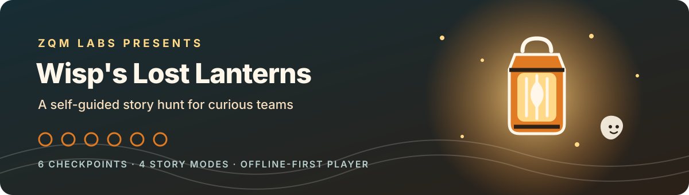

# lantern-player

<p align="center">
  
</p>

<!-- ZQM-START -->
<p align="center">
  <strong>ZQM Labs — Z's Quests & Mischief</strong><br>
  <a href="https://zqmlabs.com">zqmlabs.com</a> •
  <a href="https://github.com/ZQM-Labs">GitHub</a>
</p>
<!-- ZQM-END -->

The player web app (PWA) for ZQM Labs location games. Vanilla HTML/CSS/JS —
no build step, no framework. Leaflet is the only library (vendor it locally
before launch; CDN is fine for dev).

## Run

```bash
python3 -m http.server 8080
# Demo (embedded Wisp content, no backend): http://localhost:8080/?demo=1
# Live (needs lantern-backend):             http://localhost:8080/?kit=<kitId>&code=<accessCode>
```

## How a game flows

1. Team opens the kit link (or scans the start QR) → enters access code.
2. **Story/scare dial**: Cozy Glow 🎃 / Spooky 👻 / After Dark 🦇 / Overdrive 🔥 —
   selects story and puzzle variants and the visual theme. Organizer default comes from the kit.
3. Six checkpoints. Each unlocks by scanning the QR sign (the code is in the
   URL), typing the code, or passing a GPS geofence check — every checkpoint
   also has an observation-answer fallback (accessibility + dead-battery rule).
4. Each puzzle has exactly **3 hints**: nudge → bigger hint → answer ("Ranger
   assist"). Progress persists in localStorage; with a backend, progress also
   syncs for leaderboards (office tier).
5. Finale: completion screen, team photo prompt, badge, partner/finale code.

## Language support

The player currently ships locale files for English (`en`), Spanish (`es`), French (`fr`), German (`de`), Portuguese (`pt`), Italian (`it`), and Russian (`ru`). The language selector is experimental: matching translation keys do not guarantee complete or professionally reviewed translations, and some interface text and quest-pack content may remain in English or the pack's source language. Do not advertise full localization until content coverage and language quality have been reviewed and tested.

## Content packs

The player consumes a JSON content pack exported from `lantern-content`.
`DEMO_PACK` in `app.js` is the embedded example: every stop has `story` and
`puzzle` for all four levels (`cozy`, `spooky`, `afterdark`, `overdrive`); missing variants fall back to Cozy text. Never
hardcode new story text here — author it in `lantern-content`.

## Files

- `index.html` — shell, screens (start / scare / map / puzzle / finale)
- `app.js` — game state machine, unlock logic, hint tiers, demo pack
- `styles.css` — base layout + scare themes via `body[data-scare]`
- `sw.js` — service worker: cache-first app shell (offline play)
- `manifest.webmanifest` — installable PWA metadata


<!-- ZQM-FOOTER-START -->
---

<p align="center">
  <em>Play more. Plan less.</em><br>
  <a href="https://zqmlabs.com">zqmlabs.com</a> •
  <a href="https://github.com/ZQM-Labs">ZQM Labs</a> •
  <a href="https://github.com/ZQM-Computing">ZQM Computing</a>
</p>
<!-- ZQM-FOOTER-END -->


## Release validation contract

A green unit-test or CI result is necessary but does not prove that a location-based release is ready for players. Before tagging a release, record the player commit, content-pack version, browser/device matrix, and results of the checks below. Use the [playtest protocol](https://github.com/ZQM-Labs/playtests) and keep physical observations separate from automated test results.

| Area | Minimum release check | Evidence |
|---|---|---|
| Startup | Fresh install opens the game without uncaught errors; malformed or missing pack input fails with a useful message rather than a crash | CI result and reproducible test case |
| Offline | Install/load once, disconnect the network, reload, resume progress, and confirm the documented offline scope | Device/browser, steps, outcome |
| Content | Validate the exact release pack with the authoring validator and player; test missing, malformed, and unsupported fields | Pack filename/version and test result |
| Languages | Confirm available locale choices and review actual story/UI coverage; do not infer translation completeness from matching key counts | Locale coverage report and reviewer |
| QR and GPS | Test printed QR codes at actual size and lighting; test GPS on the intended route and record drift/failure behavior | Route/device notes and photos only where safe |
| Accessibility and safety | Verify the non-GPS observation fallback, route permissions, safe sign placement, and an accessible alternative for each checkpoint | Completed organizer checklist |
| Assets | Confirm every referenced image/audio/font file exists in the standalone package, not only in the marketing-site bundle | Asset check output |
| Recovery | Verify refresh/reopen behavior, progress persistence, and the documented recovery path for a failed checkpoint | Playtest record |

Do not publish a physical-validation claim until the route, signs, and accessible alternatives have actually been checked in the field. Do not publish a language as fully supported solely because a locale file exists.


## Release status is evidence-based

A working local demo, a successful automated workflow, and a field-ready paid game are different states. This README does not establish that Wisp's Lost Lanterns is currently orderable or approved for an in-person event. Before calling it released, link a dated release record that identifies the exact player and content versions and includes browser/device, offline/update, asset, language, QR/GPS, accessibility/safety, and checkout/fulfillment evidence. If evidence is missing, record the status as **unknown** and keep public copy limited to the state that has actually been verified.